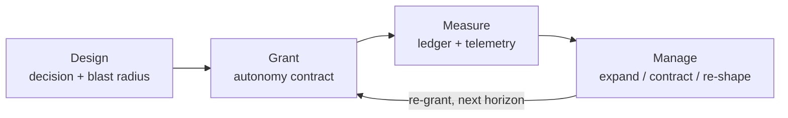

# `mama` — measuring and managing autonomy

> **Names — read this first.**
> **`mama`** (lowercase, in prose and code) = *measuring and managing
> autonomy* — **this** method and toolkit: the autonomy-governance component
> that makes delegated decision rights explicit, assessable, and manageable.
> This repository is `mama`'s **canonical home**.
> **MAMA** (uppercase) = *Measuring Automation, Managing Autonomy* — the
> broader, integrated framework
> ([umbrella organization](https://github.com/Measuring-Automation-Managing-Autonomy))
> that uses `mama` alongside automation measurement, project/portfolio
> context, and business outcomes. The two names are **not interchangeable**,
> and this repository is not the MAMA umbrella home. See the
> [integration guide](https://github.com/emmanuel-a-otchere/measuring-and-managing-autonomy/blob/main/docs/mama-integration.md).

**Status: v2.0.0 — current release; method pilot / under validation** (see
the [validation plan](https://github.com/emmanuel-a-otchere/measuring-and-managing-autonomy/blob/main/docs/validation-plan.md)
and [limitations](https://github.com/emmanuel-a-otchere/measuring-and-managing-autonomy/blob/main/docs/limitations.md)).

`mama` answers three questions for each **decision domain** of a **unit** —
a person, team, service, department, AI agent, or other sociotechnical unit:

1. **Design** — What decision authority should this unit have, and why?
2. **Measure** — What authority is granted, how is it exercised, and how
   capable and controlled is the unit?
3. **Manage** — Based on evidence, should the grant expand, contract, be
   reshaped, or be revoked?

Most organizations manage autonomy implicitly — it emerges from trust,
tenure, and accidents of structure, and is therefore felt but not measured,
expanded but never designed, and revoked arbitrarily. `mama` makes autonomy
an **explicit, designed, measurable property** of the organization.

## The method in one diagram



## What's here

| Document | Purpose |
|---|---|
| [Method handbook](https://github.com/emmanuel-a-otchere/measuring-and-managing-autonomy/blob/main/docs/handbook.md) | The end-to-end operating guide — start here |
| [Facilitator guide](https://github.com/emmanuel-a-otchere/measuring-and-managing-autonomy/blob/main/docs/facilitator-guide.md) | How to run an assessment session so the numbers mean something |
| [Training module](https://github.com/emmanuel-a-otchere/measuring-and-managing-autonomy/blob/main/docs/training.md) | Self-guided ~60-minute walkthrough with exercises |
| [Crosswalks](https://github.com/emmanuel-a-otchere/measuring-and-managing-autonomy/blob/main/docs/crosswalks.md) | `mama` vs TM Forum MAMA, NIST AI RMF, ISO/IEC 42001 & 23894, OECD, OWASP GenAI, MITRE ATLAS — coverage and gaps |
| [Export format](https://github.com/emmanuel-a-otchere/measuring-and-managing-autonomy/blob/main/docs/export-format.md) | Machine-readable scorecard export for consumers (JSON Schema included) |
| [Framework](https://github.com/emmanuel-a-otchere/measuring-and-managing-autonomy/blob/main/docs/framework.md) | Definitions, the three axes, definitive levels L1–L5 above the Submarine Line (L0), autonomy contracts |
| [Maturity model](https://github.com/emmanuel-a-otchere/measuring-and-managing-autonomy/blob/main/docs/maturity-model.md) | Six dimensions × level grid, scoring rules, the Autonomy Ledger |
| [Assessment](https://github.com/emmanuel-a-otchere/measuring-and-managing-autonomy/blob/main/docs/assessment.md) | The questionnaire and scoring procedure — the practical instrument |
| [Governance loop](https://github.com/emmanuel-a-otchere/measuring-and-managing-autonomy/blob/main/docs/governance-loop.md) | Grant → Instrument → Observe → Review, with cadence and anti-patterns |
| [Positioning](https://github.com/emmanuel-a-otchere/measuring-and-managing-autonomy/blob/main/docs/positioning.md) | Related work, lineage, open questions, BibTeX |
| [Worked example](https://github.com/emmanuel-a-otchere/measuring-and-managing-autonomy/blob/main/examples/README.md) | One team, scored end to end, producing a governance move |
| [AI agents as units](https://github.com/emmanuel-a-otchere/measuring-and-managing-autonomy/blob/main/docs/agents-as-units.md) | First-pass extension: scoring agent units with the same instrument |
| [Ledger format](https://github.com/emmanuel-a-otchere/measuring-and-managing-autonomy/blob/main/docs/ledger-format.md) | Machine-readable Autonomy Ledger (schema 2) + health checks |
| [Contract template](https://github.com/emmanuel-a-otchere/measuring-and-managing-autonomy/blob/main/docs/contract-template.md) | Autonomy contract + review agenda, ready to copy |
| [v1 → v2 migration](https://github.com/emmanuel-a-otchere/measuring-and-managing-autonomy/blob/main/docs/migration-v1-to-v2.md) | Re-baselining guide and historical-score policy |
| [MAMA integration](https://github.com/emmanuel-a-otchere/measuring-and-managing-autonomy/blob/main/docs/mama-integration.md) | The `mama` ↔ MAMA interface: what each owns, how outputs link |
| [Limitations](https://github.com/emmanuel-a-otchere/measuring-and-managing-autonomy/blob/main/docs/limitations.md) | What the method does and does not claim |
| [Validation plan](https://github.com/emmanuel-a-otchere/measuring-and-managing-autonomy/blob/main/docs/validation-plan.md) | The evidence program behind the "under validation" label |
| [Versioning](https://github.com/emmanuel-a-otchere/measuring-and-managing-autonomy/blob/main/docs/versioning.md) | Ruleset/ledger versioning policy — how assessments stay comparable |
| [Changelog](https://github.com/emmanuel-a-otchere/measuring-and-managing-autonomy/blob/main/CHANGELOG.md) | Every change, classified by comparability impact |
| [Governance](https://github.com/emmanuel-a-otchere/measuring-and-managing-autonomy/blob/main/GOVERNANCE.md) | Stewardship roles, decision rights, appeals |

## Who it is for

Grantors and governance leads who delegate decision authority and need it
legible; team leads and unit owners who hold it; risk, security, and
AI-governance functions that must evidence control over autonomous behavior;
and practitioners assessing AI agents as units. Scores are **evidence inputs
to human governance decisions** — they never authorize a deployment by
themselves.

## Install

**No Python needed** — standalone binaries for macOS, Linux, and Windows are
attached to each [GitHub Release](https://github.com/emmanuel-a-otchere/measuring-and-managing-autonomy/releases):
download `autonomy-score-<os>-<arch>` and `ledger-health-<os>-<arch>`, mark
them executable, run.

**With Python 3.9+** (installs the `autonomy-score` and `ledger-health`
commands):

```bash
pipx install measuring-autonomy    # or: pip install measuring-autonomy
```

(The distribution keeps the name `measuring-autonomy`; the method is `mama`.)

**From a clone**, the zero-install form keeps working with no packaging step:
`python3 tools/autonomy_score.py ...` (the `tools/` scripts are shims over
`src/measuring_autonomy/`). All tools run locally and offline; assessment and
ledger data leave your environment only if you send them somewhere.

## Quick start: score a team

```bash
python3 tools/autonomy_score.py 2 4 3 3 2 2 --current 2
```

Scores are D1 clarity, D2 capability, D3 guardrails, D4 telemetry,
D5 transparency, D6 accountability (0–5 each: definitive levels 1–5, and
0 — the **Submarine Line** — for no autonomy at all). The tool applies the
weakest-link rule — `min(guardrails, telemetry, accountability)` — and
outputs the safe grant level and recommended move.

```bash
python3 tools/autonomy_score.py --self-test   # verify the scoring rules
```

Track granted autonomy in a machine-readable **Autonomy Ledger** (schema 2
YAML, [`examples/ledger.yaml`](https://github.com/emmanuel-a-otchere/measuring-and-managing-autonomy/blob/main/examples/ledger.yaml)) and check its health:

```bash
python3 tools/ledger_health.py examples/ledger.yaml   # requires PyYAML (pip install pyyaml)
```

## Try it without a terminal

A dependency-free web version of the assessment lives in [`site/`](https://github.com/emmanuel-a-otchere/measuring-and-managing-autonomy/tree/main/site/)
(and is published to GitHub Pages when enabled — repo **Settings → Pages →
Source: GitHub Actions**). Open `site/index.html` locally, tick the items
with evidence, and print the scorecard.

## Roadmap

See [docs/roadmap.md](https://github.com/emmanuel-a-otchere/measuring-and-managing-autonomy/blob/main/docs/roadmap.md) — current phase, shipped releases, and what
validation work remains.

## Contributing

Feedback, corrections, and real-world applications are very welcome — see
[CONTRIBUTING.md](https://github.com/emmanuel-a-otchere/measuring-and-managing-autonomy/blob/main/CONTRIBUTING.md). Use the issue templates to report
framework feedback or submit a case study. Security issues: [SECURITY.md](https://github.com/emmanuel-a-otchere/measuring-and-managing-autonomy/blob/main/SECURITY.md). Governance and appeals: [GOVERNANCE.md](https://github.com/emmanuel-a-otchere/measuring-and-managing-autonomy/blob/main/GOVERNANCE.md).

## License

[MIT](https://github.com/emmanuel-a-otchere/measuring-and-managing-autonomy/blob/main/LICENSE)
