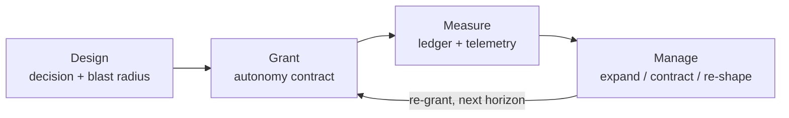

# Measuring and Managing Autonomy

Autonomy from a business and systems point of view can be challenging to
manage. This project defines a framework by which managing and measuring
autonomy can be designed and implemented.

Most organizations manage autonomy implicitly — it emerges from trust, tenure,
and accidents of structure, and is therefore felt but not measured, expanded
but never designed, and revoked arbitrarily. This framework makes autonomy an
**explicit, designed, measurable property** of the organization.

## The framework in one diagram



## What's here

| Document | Purpose |
|---|---|
| [Framework](docs/framework.md) | Definitions, the three axes, the five levels (L0–L4), autonomy contracts |
| [Maturity model](docs/maturity-model.md) | Six dimensions × five levels grid, scoring rules, the Autonomy Ledger |
| [Assessment](docs/assessment.md) | The questionnaire and scoring procedure — the practical instrument |
| [Governance loop](docs/governance-loop.md) | Grant → Instrument → Observe → Review, with cadence and anti-patterns |
| [Positioning](docs/positioning.md) | Related work, lineage, open questions, BibTeX |
| [Worked example](examples/README.md) | One team, scored end to end, producing a governance move |

## Quick start: score a team

```bash
python3 tools/autonomy_score.py 1 3 2 2 1 1 --current 1
```

Scores are D1 clarity, D2 capability, D3 guardrails, D4 telemetry,
D5 transparency, D6 accountability (0–4 each). The tool applies the
weakest-link rule — `min(guardrails, telemetry, accountability)` — and
outputs the safe grant level and recommended move.

```bash
python3 tools/autonomy_score.py --self-test   # verify the scoring rules
```

## The three questions

1. **Design** — What autonomy should this unit have, and why? →
   [contracts](docs/framework.md#5-autonomy-contracts)
2. **Measurement** — How much autonomy exists, and how well is it used? →
   [maturity model](docs/maturity-model.md) + [assessment](docs/assessment.md)
3. **Management** — When should autonomy expand, contract, or re-shape? →
   [governance loop](docs/governance-loop.md)

## Roadmap

See [docs/roadmap.md](docs/roadmap.md). Current status: **v0.1 draft** — the
written framework, maturity model, and assessment instrument are complete;
next up are validation against real teams and optional tooling.

## Contributing

Feedback, corrections, and real-world applications are very welcome — see
[CONTRIBUTING.md](CONTRIBUTING.md). Use the issue templates to report
framework feedback or submit a case study.

## License

[MIT](LICENSE)
