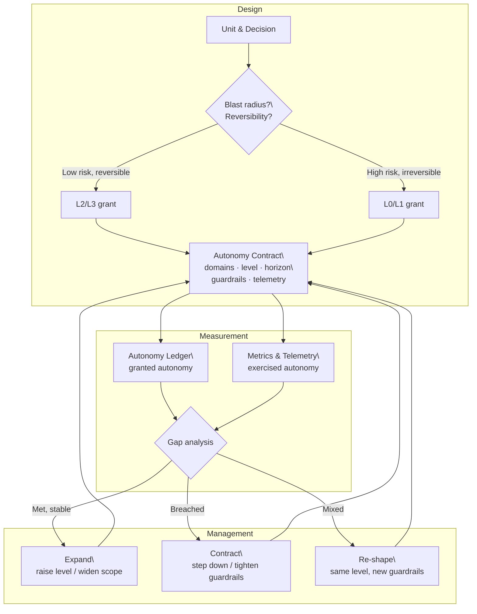

# The Measuring & Managing Autonomy Framework

> **Status:** v0.1 draft. This document is the written form of the framework
> introduced in the original [diagram](#framework-diagram). Feedback welcome —
> see [Contributing](../CONTRIBUTING.md).

## 1. Why this framework exists

Autonomy — the freedom of a person, team, or system to make and act on decisions
without pre-approval — is one of the most powerful and one of the most dangerous
properties an organization can grant. Too little autonomy creates bottlenecks,
disengagement, and slow response; too much autonomy creates inconsistency,
unbounded risk, and chaos.

Most organizations manage autonomy implicitly: it emerges from trust, tenure,
and accidents of structure. The result is that autonomy is **felt but not
measured, expanded but never designed, and revoked arbitrarily**.

This framework makes autonomy an explicit, designed, and measurable property of
the organization. It answers three questions:

1. **Design** — What autonomy should this unit have, and why?
2. **Measurement** — How much autonomy does this unit actually have, and how
   well is it exercising it?
3. **Management** — When should autonomy expand, contract, or change shape?

## 2. Core definitions

| Term | Definition |
|---|---|
| **Unit** | The entity being granted autonomy: a person, team, service, department, or (increasingly) an AI agent. |
| **Decision** | A choice among alternatives that commits resources, changes state, or affects others. |
| **Decision right** | The authority to make a specific class of decisions, at a specific autonomy level, within a defined scope. |
| **Autonomy** | The set of decision rights a unit holds, and the level at which it holds them. |
| **Blast radius** | The maximum harm (cost, customers, data, reputation, safety) if a decision is wrong. |
| **Reversibility** | How easily and quickly a wrong decision can be undone (hours vs. never). |
| **Guardrail** | A constraint or safety mechanism that makes a higher autonomy level safe (limits, budgets, checklists, automated rollback). |
| **Escalation path** | The pre-agreed route a decision takes when it exceeds the unit's scope. |

## 3. The three axes of autonomy

Autonomy is not one number. Every decision right is positioned along three
axes, and these axes determine what "level" is appropriate.

### Axis 1 — Scope
*What* the unit may decide: which domains (spending, hiring, architecture,
release, external communication…), over what objects, affecting which parties.

### Axis 2 — Level
*How far* the unit may go within a scope, without asking anyone. See
[§4 Levels](#4-the-five-levels-of-autonomy).

### Axis 3 — Horizon
*When* the unit's authority expires or is reviewed. Autonomy is always
time-boxed and re-grantable, never permanent or implicit.

## 4. The five levels of autonomy

Adapting the delegation ladder common in safety-critical systems to business
settings:

| Level | Name | Meaning | Analogy |
|---|---|---|---|
| **L0** | **Ask** | Unit may analyze and recommend, but every decision requires approval. | Apprentice |
| **L1** | **Inform-after** | Unit decides and acts, then reports what it decided. Decisions reviewable and reversible by the grantor. | Junior with a manager |
| **L2** | **Guardrailed** | Unit decides and acts freely within explicit, pre-agreed limits (budgets, allow-lists, rate limits, checklists). | Credit card with a limit |
| **L3** | **Supervised** | Unit decides and acts; a monitoring function observes for exceptions and intervenes on trigger, not on pre-approval. | Autonomous car with safety driver |
| **L4** | **Accountable** | Unit owns the domain outright, including the right to redesign its own guardrails, subject only to outcome accountability and transparency duties. | Business unit P&L owner |

Two rules govern level assignment:

- **The guardrail rule:** a unit may operate at level *n* only if the
  guardrails for level *n* exist and are tested. Level without guardrail is
  negligence, not trust.
- **The reversibility rule:** expected level rises with reversibility and falls
  with blast radius. High blast radius + low reversibility ⇒ L0–L1 regardless
  of how trusted the unit is. Guardrails move decisions up the ladder by
  improving effective reversibility (automatic rollback, canary, spending cap).

## 5. Autonomy contracts

The basic management artifact is an **autonomy contract**: a short, written
agreement per unit covering:

1. **Domains** — the decision classes granted (Axis 1).
2. **Level per domain** (Axis 2), with the specific guardrails that justify it.
3. **Horizon** (Axis 3) — review date or expiry.
4. **Telemetry** — the metrics the unit must expose to keep the level.
5. **Escalation path** — what happens when a decision exceeds scope.
6. **Revocation triggers** — the observable conditions under which the grantor
   unilaterally steps down a level.

A contract makes autonomy *legible*: grantable by design, auditable, and
removable without drama.

## 6. Measuring autonomy

The framework measures two different things, and confusing them is the classic
mistake:

- **Granted autonomy (supply):** what the organization has actually delegated,
  as recorded in autonomy contracts. Measured with the
  [Autonomy Ledger](maturity-model.md#the-autonomy-ledger).
- **Exercised autonomy (demand):** how much the unit uses and how well it
  performs with what it has. Measured with the
  [Maturity Model](maturity-model.md) and the
  [Assessment](assessment.md).

Gaps between the two are the interesting signal:
granted-but-unused autonomy signals unclear contracts, fear, or missing
capability; used-but-not-granted autonomy signals shadow autonomy — risk that
exists on no ledger.

## 7. The management loop

Autonomy is managed with a standing loop (see
[the Governance Loop](governance-loop.md) for the full operating procedure):

```
Grant → Instrument → Observe → Review → Expand / Contract / Re-shape
```

Every grant is time-boxed; every review compares telemetry against the
contract; and the outcome is always one of three moves: **expand** (raise a
level, widen scope), **contract** (step down, tighten guardrails), or
**re-shape** (same level, different guardrails).

## Framework diagram



*(Mermaid renders natively on GitHub. The original 2022 concept diagram is
preserved as `docs/img/original-diagram.png` if provided; see
[Contributing](../CONTRIBUTING.md).)*

## Next steps

- [Maturity Model](maturity-model.md) — the measurement grid
- [Assessment](assessment.md) — the questionnaire and scoring procedure
- [Governance Loop](governance-loop.md) — the operating procedure
- [Positioning](positioning.md) — related work and sources
- [AI agents as units](agents-as-units.md) — applying this framework to agent units
- [Worked example](../examples/README.md) — one team, scored end to end
