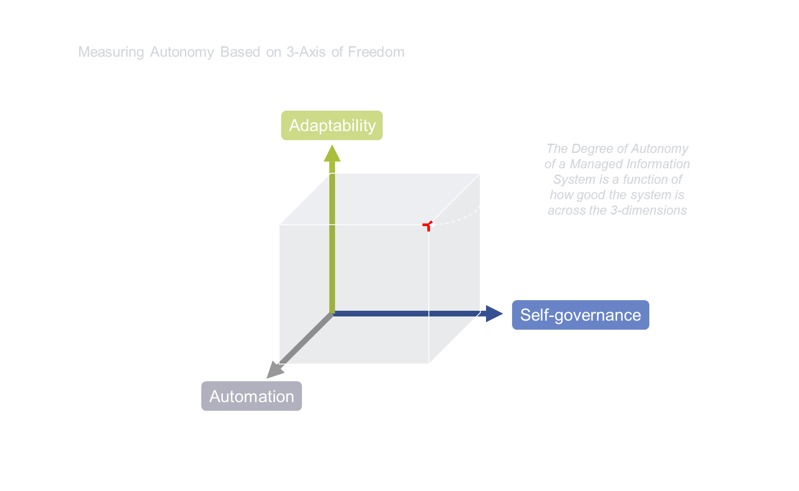

# Original concept diagram (2022)

**Title:** *Measuring Autonomy Based on 3-Axis of Freedom*

**Provenance:** This is the original concept diagram from the repository's
first commits (24 August 2022), previously hotlinked from
`user-images.githubusercontent.com`. It is archived here (84 KB, 1810×1114 PNG)
so the project's lineage is versioned with the code and cannot rot behind an
external URL.

## What it shows

A managed information system's degree of autonomy is a function of how good
the system is across three dimensions, drawn as a 3-axis cube:

| Original axis (2022) | Meaning |
|---|---|
| **Self-governance** | The system's ability to make and enforce its own decisions |
| **Adaptability** | The system's ability to change its behavior as conditions change |
| **Automation** | The degree to which execution proceeds without human action |

## How it maps to the current framework

The 2022 axes were the seed of today's
[three axes of autonomy](../framework.md#3-the-three-axes-of-autonomy),
reinterpreted for organizational units:

| Original axis | Current framework descendant |
|---|---|
| Self-governance | **Axis 2 — Level** (L0 Ask → L4 Accountable): self-governance is not binary but a designed ladder of decision rights |
| Adaptability | **Axis 1 — Scope** + the [governance loop](../governance-loop.md): adaptability is managed by widening/narrowing granted scope at review, not left implicit |
| Automation | **Axis 3 — Horizon** + guardrails: how much runs without pre-approval is bounded by tested guardrails and re-granted on a time box |

The key evolution: the original diagram *measured* autonomy as a position in
a space; the current framework *manages* it — the position is now a designed
grant (an [autonomy contract](../contract-template.md)), measured on both
supply and demand, and moved deliberately (expand / contract / re-shape).
